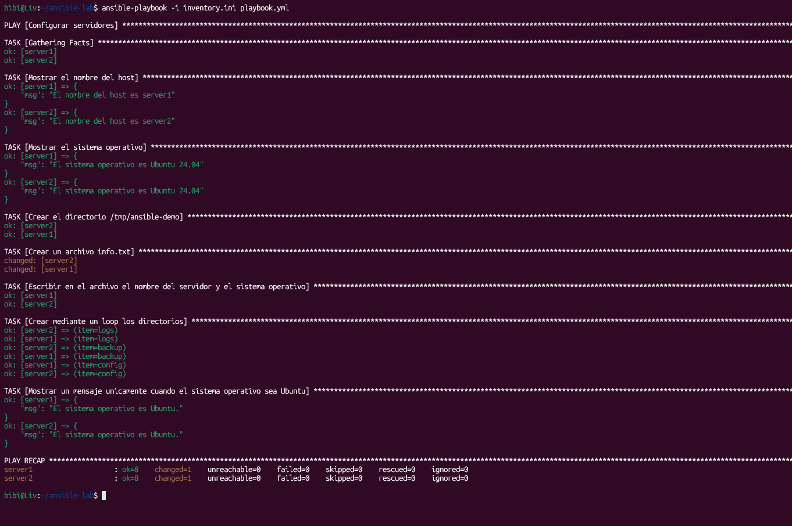

# Laboratorio de ansible con docker

## Objetivo de la práctica
Aprender a usar Ansible para gestionar y configurar dos servidores basados en Ubuntu que se ejecutan dentro de contenedores Docker. En esta práctica se obtienen datos básicos del sistema, se crean carpetas y archivos, y se ejecutan tareas condicionales.

## Comandos para iniciar los contenedores
1. Iniciar los dos servidores en segundo plano:
```bash
docker compose up -d
```

2. Comprobar que ambos contenedores están en ejecución:
```bash
docker ps
```

3. Instalar Python en el primer servidor:
```bash
docker exec -it server1 bash
apt update
apt install -y python3
exit
```

4. Instalar Python en el segundo servidor:
```bash
docker exec -it server2 bash
apt update
apt install -y python3
exit
```

5. Probar la conexión desde Ansible:
```bash
ansible docker -i inventory.ini -m ping
```

## Comando para ejecutar el playbook
Ejecutar las tareas definidas en el archivo de configuración:
```bash
ansible-playbook -i inventory.ini playbook.yml
```

## Captura de pantalla de la ejecución exitosa

